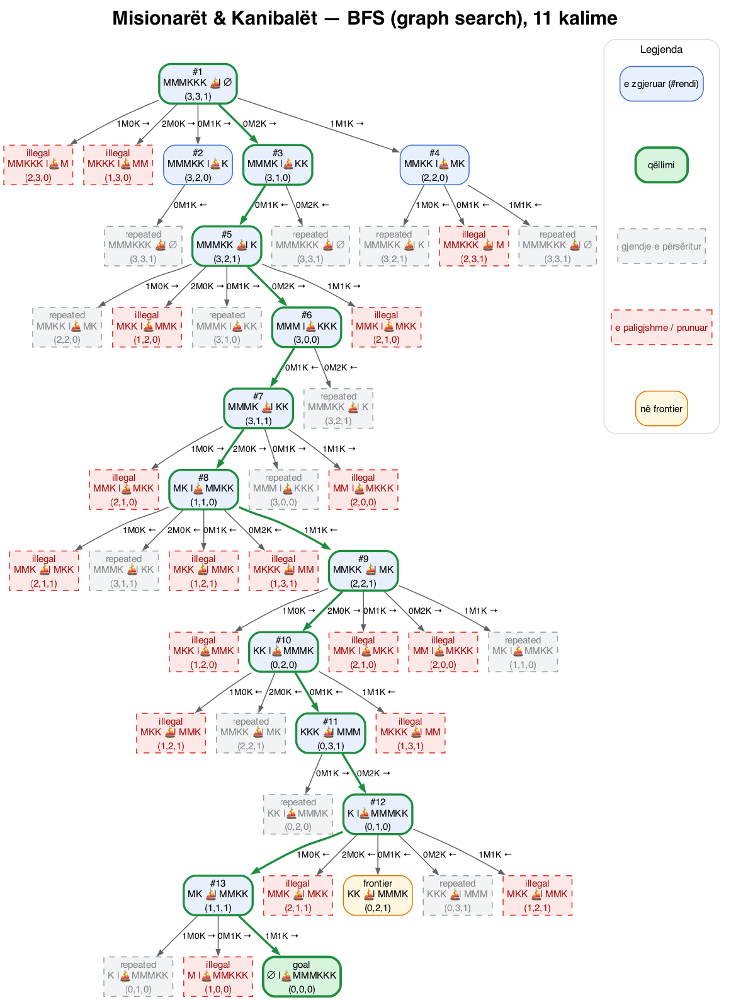
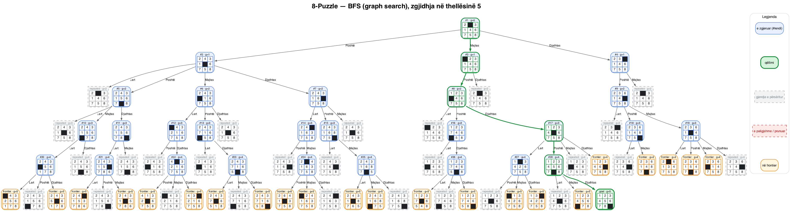
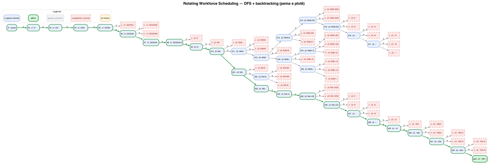
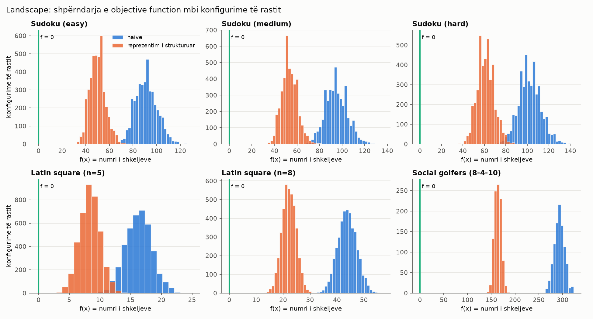
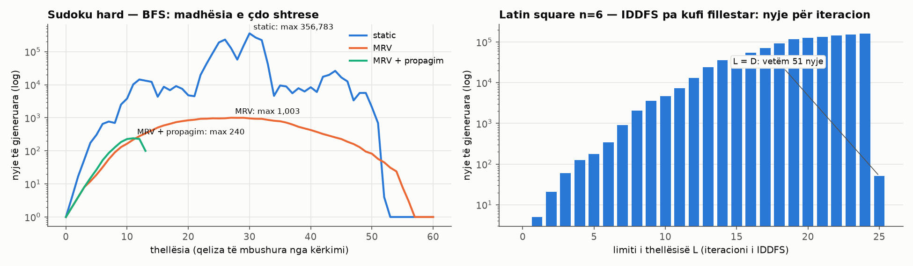

# Uninformed Search Techniques

Implementation and analysis of **Depth-First Search, Breadth-First Search and Iterative Deepening DFS (with backtracking)** on classic constraint-satisfaction and state-space problems: the Social Golfers Problem, Sudoku, Latin squares, and search-tree construction for the 8-Puzzle, Missionaries & Cannibals and Rotating Workforce Scheduling.

> Coursework for the Artificial Intelligence course (Master's level) — Faculty of Electrical and Computer Engineering, University of Prishtina "Hasan Prishtina".

  

---

## Contents

- [Results at a glance](#results-at-a-glance)
- [Getting started](#getting-started)
- [Usage](#usage)
- [Project structure](#project-structure)
- [Approach](#approach)
- [1. Social Golfers — DFS](#1-social-golfers--dfs--backtracking)
- [2. Sudoku — BFS](#2-sudoku--bfs--backtracking)
- [3. Latin Square — IDDFS](#3-latin-square--iddfs--backtracking)
- [4. Search Trees](#4-search-trees)
- [Landscape analysis](#landscape-analysis)
- [Testing](#testing)
- [Limitations](#limitations)
- [References](#references)

---

## Results at a glance

| Problem | Algorithm | Outcome |
|---|---|---|
| **Social Golfers** (32 players, groups of 4) | DFS + backtracking | Upper bound proven at **10 weeks**. DFS finds **9 weeks in 408 nodes (~1 ms)** using a GF(2)⁵ reformulation and proves 10 weeks impossible within that model. The published 10-week schedule (Aguado, 2004) is included and validated. |
| **Sudoku** (Easy / Medium / Hard) | BFS + backtracking | All levels solved. On Hard, MRV + propagation needs **2,170 nodes** versus **2,068,780** with static ordering. |
| **Latin square** | IDDFS + backtracking | Backtrack-free search via Hall's theorem; **n = 100 in 5.4 s**. |
| **Search trees** | BFS / DFS | 8-Puzzle in 5 moves, Missionaries & Cannibals in 11 crossings (both optimal), feasible RWS schedule (f = 0). |

Every solution is verified by an independent validator that does not reuse solver code. All figures in this document are **measured** and reproducible with `python main.py all` (`results/run_all.txt`, `results/landscape.json`).

---

## Getting started

**Requirements:** Python 3.10+. The solvers use only the standard library; `matplotlib` is needed for the landscape figures and [Graphviz](https://graphviz.org/) (`dot`) for rendering search trees.

```bash
git clone https://github.com/agnesarama1/uninformedSearchAlgorithms.git
cd uninformedSearchAlgorithms

python -m venv .venv
source .venv/bin/activate          # Windows: .venv\Scripts\activate
pip install -r requirements.txt

brew install graphviz              # macOS  (Linux: sudo apt install graphviz)
```

---

## Usage

```bash
python main.py all                                   # run every problem, write results/benchmarks.json

# 1. Social Golfers (DFS)
python main.py golfers --weeks 9                     # GF(2)^5 subspace model
python main.py golfers --weeks 6 --model restarts    # direct model + Luby restarts
python main.py golfers --weeks 5 --model direct      # direct model, plain DFS
python main.py golfers --model published             # validate the published 10-week schedule

# 2. Sudoku (BFS)
python main.py sudoku --level hard --propagate
python main.py sudoku --generate --seed 1            # new puzzles with a unique solution

# 3. Latin Square (IDDFS)
python main.py latin --n 5 --cyclic                  # textbook IDDFS, L = 0, 1, 2, ...
python main.py latin --n 30 --start-at-depth         # large n: single pass at L = D

# 4. Search trees
python main.py trees                                 # -> results/trees/*.svg | *.png

# Analysis and tests
python landscape.py                                  # -> results/landscape.json + figures
python -m unittest discover -s tests -v
```

> Console output and figure labels are in Albanian.

---

## Project structure

```
.
├── main.py                 # command-line interface
├── landscape.py            # search-space and objective-function analysis
├── search/
│   └── core.py             # generic search engine: DFS, BFS, IDDFS, statistics, budgets
├── problems/
│   ├── golfers.py          # Social Golfers: direct model + GF(2)^d spread model
│   ├── sudoku.py           # Sudoku: bitmasks, MRV, propagation, puzzle generator
│   ├── latin.py            # Latin squares / quasigroup completion, Hall matching check
│   └── trees.py            # 8-Puzzle, Missionaries & Cannibals, RWS, Graphviz rendering
├── data/
│   └── social_golfers_8x4x10.json   # published 10-week schedule (Aguado, 2004)
├── tests/
│   └── test_all.py         # 30 tests with solver-independent validators
└── results/                # benchmarks, figures and rendered search trees
```

---

## Approach

All three CSPs share one **incremental formulation**, implemented once in `search/core.py`:

- **State:** a partial assignment of the variables. **Action:** assign a value to the next variable.
- **Backtracking:** `actions()` yields only values consistent with the current assignment, so a branch is pruned the moment a constraint is violated rather than at a leaf.
- **Memory model:** DFS and IDDFS mutate the state in place (`apply` / `undo`, O(d) memory). BFS works on copies, because the entire frontier must coexist.
- **Tree, not graph:** with a fixed variable order every partial assignment is reached by exactly one path, so the CSPs need no explored set.
- **Still uninformed:** MRV ordering and constraint propagation are CSP consistency techniques. Neither one estimates distance to a goal.

The engine records nodes generated, expanded and pruned, backtracks, peak frontier size, nodes per depth and per IDDFS iteration, and the effective branching factor *b\**.

---

## 1. Social Golfers — DFS + backtracking

**Question:** 32 golfers play once a week in groups of 4. For how many weeks can they play so that no two golfers share a group more than once?

**Upper bound:** each week a golfer meets 3 new players out of 31, so **w ≤ ⌊31/3⌋ = 10**.

**Answer: 10 weeks.** The first explicit 10-week schedule was published by A. Aguado (2004); it is stored in `data/social_golfers_8x4x10.json` and checked by the independent validator (`--model published`). This schedule is a published construction, not a DFS result: the search here reaches 9 weeks with Model B and 7 with Model A.

### Model A — direct formulation

| Component | Definition |
|---|---|
| Variables | X<sub>w,g,k</sub> = golfer in week *w*, group *g*, position *k* (32·w variables) |
| Domain | {0, …, 31} |
| C1 | each week partitions the 32 golfers (AllDifferent per week) |
| C2 | every pair of golfers shares a group at most once |
| Objective | f(X) = Σ<sub>a<b</sub> max(0, meetings(a,b) − 1); feasible ⇔ f = 0. Optimisation: max *w* s.t. f = 0 |

- **Bit-parallel domains:** candidates for the next slot are computed in a single expression, `~week_used & ~group_union & above(last)`.
- **Symmetry breaking:** S1 fixes week 1, S2 orders golfers within a group, S3 orders groups by first golfer, and S4 orders weeks 2…w by the second golfer of group 0.
- **Look-ahead:** FC1 checks that the current group can still be completed; FC3 requires every free golfer to lie in a 4-clique of the "not yet met" graph.

| 8-4-w | Plain DFS | DFS + Luby restarts |
|---|---|---|
| 2–5 | 32(w−1) nodes, 0 backtracks | — |
| 6 | does not finish (> 15M nodes / 60 s) | 28,348 nodes, 0.06 s |
| 7 | — | 9.3M nodes, 21 s |
| 8–10 | — | does not finish within 100 s |

Plain DFS suffers from **thrashing**: a poor decision in week 2 only surfaces in week 6, and chronological backtracking never returns that far. Randomised restarts (Gomes, Selman & Kautz) discard such decisions while keeping the search complete.

### Model B — structural reformulation over GF(2)⁵

Golfers are the vectors of GF(2)⁵, and a week is the set of 8 cosets of a 2-dimensional subspace *U*. Two golfers *x*, *y* share a group ⇔ *x ⊕ y ∈ U \ {0}*, so two weeks repeat no pair ⇔ *U<sub>i</sub> ∩ U<sub>j</sub> = {0}*. The problem therefore reduces to a **partial spread**: choose *w* of the 155 subspaces with pairwise disjoint non-zero parts.

| Weeks | Nodes | Time |
|---|---:|---:|
| ≤ 7 | ≤ 8 | < 0.1 ms |
| 9 | **408** | **~1 ms** |
| 10 | 7,450,353 (exhaustive) | 14.8 s → **infeasible within the linear model** |

This agrees with theory: the largest partial spread of lines in PG(4,2) has size 9.

### Search-space size

| Representation | log₁₀ \|S\| |
|---|---:|
| Naive, 32<sup>32·10</sup> | 481.6 |
| Weekly partitions (5.93·10¹⁹ per week)<sup>10</sup> | 197.7 |
| After symmetry breaking (S1 + S4) | 172.4 |
| Model B, C(155, 10) | **15.2** |

---

## 2. Sudoku — BFS + backtracking

| Component | Definition |
|---|---|
| Variables | X<sub>i</sub>, i = 0…80 |
| Domain | {1, …, 9}, or the given clue |
| Constraints | AllDifferent on 27 units (9 rows, 9 columns, 9 boxes) |
| Action | (cell, digit) consistent with its row, column and box — an O(1) bitmask check |
| Objective | f(x) = Σ<sub>units</sub> Σ<sub>i<j</sub> [x<sub>i</sub> = x<sub>j</sub>]; solution ⇔ f = 0 and all clues respected |

**Difficulty levels:** three reference puzzles (uniqueness verified by tests) plus a generator, `generate(level)`, that builds a full grid with randomised DFS and removes cells only while the solution stays unique (Easy 36–40, Medium 28–32, Hard 22–26 clues).

| Level | Configuration | BFS nodes | Peak frontier | Time |
|---|---|---:|---:|---:|
| Easy (32 clues) | static | 928 | 146 | 2 ms |
| | MRV | 49 | 1 | < 1 ms |
| | MRV + propagation | 0 (solved by propagation) | 0 | < 1 ms |
| Medium (28 clues) | static | 22,918 | 3,616 | 70 ms |
| | MRV | 205 | 9 | 1 ms |
| | MRV + propagation | 21 | 3 | 1 ms |
| Hard (21 clues) | static | 2,068,780 | **356,812** | 17.9 s |
| | MRV | 24,880 | 1,003 | 0.15 s |
| | MRV + propagation | 2,170 | 243 | 0.08 s |

Every solution lies at depth *d* = number of empty cells, so BFS must materialise each layer in full. This is the O(b<sup>d</sup>) memory cost of BFS, observed directly: 356,812 simultaneous states on Hard with static ordering.

| Level | Empty cells | log₁₀ 9<sup>e</sup> | log₁₀ Π\|D<sub>i</sub>\| | log₁₀ row permutations |
|---|---:|---:|---:|---:|
| Easy | 49 | 46.8 | 23.2 | 21.9 |
| Medium | 53 | 50.6 | 28.6 | 25.1 |
| Hard | 60 | 57.3 | 37.0 | 30.8 |

The trees actually explored contain 10¹–10⁶ nodes.

---

## 3. Latin Square — IDDFS + backtracking

| Component | Definition |
|---|---|
| Variables | X<sub>r,c</sub>, n² variables |
| Domain | {1, …, n} |
| Constraints | AllDifferent on every row and every column |
| Goal | all cells filled — **every solution lies at depth D = number of empty cells** |
| Symmetry | reduced form (row 0 and column 0 fixed to 1…n), giving D = (n−1)² |
| Objective | f = Σ<sub>r</sub> (n − \|unique(r)\|) + Σ<sub>c</sub> (n − \|unique(c)\|) |

### Why textbook IDDFS is expensive here

The default mode is textbook IDDFS (L = 0, 1, 2, …). Because every solution sits at maximal depth, each iteration with L < D must exhaust the whole pruned tree before deepening. Figures below are without the matching check (`--no-matching`); with it, n = 5 takes 4,173 nodes and n = 6 takes 936,831, over the same number of iterations.

| n | Iterations | Total nodes | Nodes in final iteration | Overhead |
|---|---:|---:|---:|---:|
| 5 | 17 | 4,897 | 28 | 175× |
| 6 | 26 | 1,194,051 | 51 | 23,413× |
| ≥ 7 | — | > 10⁸ | — | — |

If the textbook run exhausts `--seconds` (in practice for n ≥ 7), the program reports it and falls back to `--start-at-depth`, so a square is still printed; results from that fallback come from the single L = D pass.

### Optimisations

1. **Exact starting depth** (`--start-at-depth`, `start_limit = D`). Each action fills exactly one cell, so D is an exact lower bound and completeness is preserved. Only one iteration remains, which makes this depth-limited DFS in practice. It is required for n ≥ 7, and the table below uses this mode.
2. **Perfect-matching check** (Kuhn's algorithm, warm-started) on the affected row and column. By **Hall's marriage theorem** every Latin rectangle extends to a full square, so with row-major ordering the search is **backtrack-free**. This was verified empirically: nodes = D + rejected values, with 0 backtracks.
3. **Iterative depth-limited search:** n = 50 has D = 2,401, which exceeds Python's recursion limit.

| n | Static ordering: nodes / time | MRV: nodes / time |
|---:|---|---|
| 10 | 121 / 1 ms | 82 / 3 ms |
| 20 | 681 / 14 ms (without matching: does not finish) | 371 / 35 ms |
| 50 | 6,649 / 0.45 s | 2,533 / 0.85 s |
| 100 | 43,785 / 5.4 s | 9,943 / 14.3 s |

### Verification

- The number of reduced Latin squares for n = 1…6 is 1, 1, 1, 4, 56, 9408, matching OEIS [A000315](https://oeis.org/A000315).
- On an unsatisfiable grid, IDDFS terminates with *failure* rather than deepening forever.
- Partially filled grids (quasigroup completion) are supported.
- `--cyclic` also prints the O(n²) cyclic construction, which reproduces the assignment's example exactly.

| n | log₁₀ n<sup>n²</sup> | log₁₀ (n!)<sup>n</sup> | log₁₀ n<sup>(n−1)²</sup> | log₁₀ L(n) |
|---:|---:|---:|---:|---:|
| 5 | 17.5 | 10.4 | 11.2 | 5.2 |
| 8 | 57.8 | 36.8 | 44.3 | 20.0 |

---

## 4. Search Trees

Trees are generated from actual search runs, not drawn by hand. Each node is labelled with its status — expanded (with expansion order), goal, repeated, illegal or frontier — and the solution path is highlighted in green. Output: `results/trees/*.svg` and `*.png`.

| Problem | State | Actions | Algorithm | Tree | Solution |
|---|---|---|---|---|---|
| 8-Puzzle | permutation of 0…8 (181,440 reachable; inversion-parity check) | move blank up / down / left / right | BFS, graph search | 78 nodes, 27 repeated | 5 moves (optimal) |
| Missionaries & Cannibals | (M<sub>left</sub>, C<sub>left</sub>, boat) | {1M, 2M, 1C, 2C, 1M1C} | BFS, graph search | 47 nodes, 18 illegal, 14 repeated | 11 crossings (optimal) |
| Rotating Workforce Scheduling | cyclic sequence of length 7n over {D, N, –} | assign the shift of day *t* | DFS + backtracking | 78 nodes to first solution, 45 pruned | f = 0 |

**Rotating Workforce Scheduling (n = 3):** demand of one day shift (D) every day and one night shift (N) Monday–Friday; work blocks of 2–5 days, rest blocks of 1–3, at most 4 consecutive D and 3 consecutive N; N → D is forbidden. The objective counts coverage shortfall or excess, block violations and forbidden sequences.

```
          Mon Tue Wed Thu Fri Sat Sun
Week 1:    D   D   D   D   N   -   D
Week 2:    N   N   -   -   D   D   -
Week 3:    -   -   N   N   -   -   -
```

The rendered RWS tree stops at the first solution. Running the same search to completion generates 49,374 nodes (32,611 pruned) and finds 306 solutions — too large to draw.

<p align="center">
  
  
</p>
<p align="center">
  
</p>

---

## Landscape analysis

`landscape.py` characterises each search space in four ways:

1. **Analytic size** of the naive and the structured representation (tables above).
2. **Distribution of f(x)** over random complete configurations — 4,000 samples per Sudoku and Latin instance, 1,000 for Golfers.
3. **Ruggedness:** a random walk with swap moves gives the lag-1 autocorrelation ρ(1) and the correlation length ℓ = −1 / ln\|ρ(1)\| (Weinberger, 1990).
4. **Search profile:** BFS layer sizes and IDDFS nodes per iteration.

| Instance | Mean f, naive → structured | ρ(1) | ℓ |
|---|---:|---:|---:|
| Sudoku Easy | 91.1 → 49.8 | 0.901 | 9.6 |
| Sudoku Medium | 94.9 → 53.3 | 0.926 | 13.0 |
| Sudoku Hard | 102.3 → 61.2 | 0.947 | 18.2 |
| Latin n = 5 | 16.4 → 8.2 | 0.773 | 3.9 |
| Latin n = 8 | 44.0 → 22.0 | 0.931 | 13.9 |
| Golfers 8-4-10 | 292.9 → 163.4 | 0.975 | 38.8 |

A structured representation roughly halves the mean violation count, yet **no random sample reaches f = 0** — generate-and-test is hopeless, and constraint pruning is essential.





---

## Testing

```bash
python -m unittest discover -s tests -v
```

The 30 tests check results against validators that are independent of the solvers:

- uniqueness of the reference Sudoku puzzles, and uniqueness and clue counts of generated ones;
- agreement between BFS and DFS on every Sudoku level;
- Latin-square counts against OEIS A000315, and that the matching check never discards a solution;
- known Social Golfers instances (3-3-4 feasible, 3-3-5 infeasible, 4-4-5 feasible, 4-3-5 infeasible) and validation of the 9-week and published 10-week schedules;
- optimal solution depth for the 8-Puzzle and Missionaries & Cannibals;
- feasibility of the RWS schedule.

---

## Limitations

- **Social Golfers, 10 weeks:** no DFS configuration in this project finds a 10-week schedule. Model B proves it impossible within the linear (subspace) structure, and Model A with restarts does not finish beyond 7 weeks. The 10-week result relies on the published construction.
- **Textbook IDDFS on Latin squares** is impractical for n ≥ 7; larger instances use `--start-at-depth`.
- **Single-threaded pure Python:** timings are indicative and machine-dependent; node counts are deterministic and the better basis for comparison.

---

## References

- S. Russell, P. Norvig — *Artificial Intelligence: A Modern Approach*, Chapters 3 and 6.
- CSPLib [prob010](https://www.csplib.org/Problems/prob010/) — Social Golfers Problem; A. Aguado (2004), 8-4-10 construction.
- C. Gomes, B. Selman, H. Kautz (1998) — *Boosting combinatorial search through randomization*; M. Luby, A. Sinclair, D. Zuckerman (1993) — *Optimal speedup of Las Vegas algorithms*.
- P. Hall (1935) — *On representatives of subsets*.
- E. Weinberger (1990) — *Correlated and uncorrelated fitness landscapes and how to tell the difference*.
- N. Musliu, J. Gärtner, W. Slany (2002) — *Efficient generation of rotating workforce schedules*.
